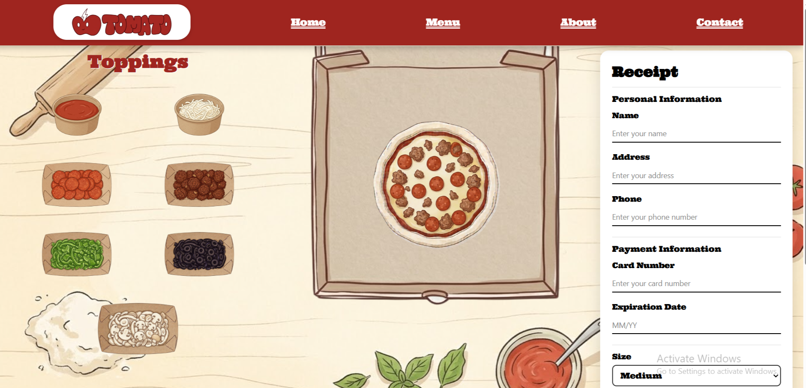

# Tomato-Pizzeria

Tomato Pizzeria is a simple pizza ordering website . The project focuses on creating a visually engaging and interactive pizza customization experience.

https://mch2707.github.io/Tomato-Pizzeria/

## About the Project

The idea behind TOMATO was to create a personalized pizza ordering experience with a distinctive visual identity. The interface combines a warm vintage-inspired design with a simple and intuitive layout.

The visual concept and illustrations were developed with AI assistance. The interface also takes inspiration from familiar social platform designs, reinterpreted and adapted to fit the TOMATO brand and its purpose.

## Features

- Custom pizza ingredient selection
- Pizza size selection
- Ingredient and topping illustrations
- Order summary and receipt section
- Customer information form
- Order placement interface
- Responsive website design

## Design

The visual identity follows a Cream & Tomato color palette, combining warm cream backgrounds, tomato-red accents, and hand-drawn illustrations.

The goal was to create a recognizable brand identity while keeping the interface easy to navigate.

**--Make your own pizza--**
